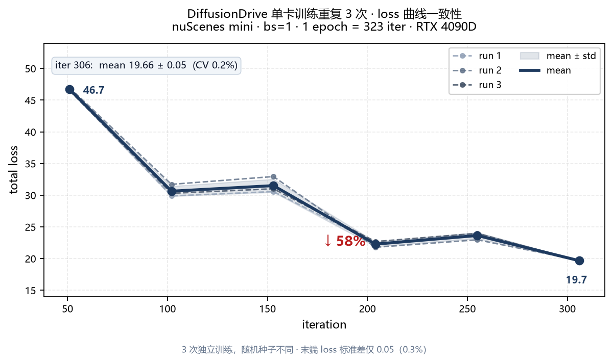

# DiffusionDrive nuScenes 分支复现

· 2026-11-23
仓库 `hustvl/DiffusionDrive` 分支 `nusc` · AutoDL RTX 4090D 24G · 单卡


---

## 1 结果

评测输出全部规划指标。训练过程中 loss 下降。数据集为 v1.0-mini。本次未复现论文的 L2 0.57。

官方权重在 81 个验证样本上的结果：

| metrics | 0.5s | 1.0s | 1.5s | 2.0s | 2.5s | 3.0s | avg |
|---|---|---|---|---|---|---|---|
| obj_col | 0.000% | 0.000% | 0.000% | 0.000% | 0.000% | 0.000% | 0.000% |
| obj_box_col | 0.000% | 0.000% | 0.000% | 0.000% | 0.000% | 0.242% | 0.081% |
| L2 (m) | 0.1453 | 0.2607 | 0.4097 | 0.5913 | 0.8038 | 1.0444 | 0.6321 |

四次重复运行的稳定性：

| run | L2 avg | obj_box_col | 耗时 |
|---|---|---|---|
| 1 | 0.6278 | 0.081% | 66 s |
| 2 | 0.6317 | 0.081% | 66 s |
| 3 | 0.6343 | 0.081% | 66 s |
| 4 | 0.6321 | 0.081% | 43 s |
| 均值 ± std | 0.6315 ± 0.0026 | 0.081% ± 0 | |

碰撞率四次数值相同。L2 波动幅度为 1%，成因见 2.5 节。

与论文数值对比：

| 指标 | 论文（v1.0 全量，150 场景） | 本次（mini，10 场景） | 差 |
|---|---|---|---|
| L2 1s | 0.27 | 0.2607 | −0.01 |
| L2 2s | 0.54 | 0.5913 | +0.05 |
| L2 3s | 0.90 | 1.0444 | +0.14 |
| L2 avg | 0.57 | 0.6321 | +0.06 |
| Col. avg | 0.08% | 0.081% | +0.001% |

L2 偏差随预测时长增加。1 秒处差 0.01 米，3 秒处差 0.14 米。碰撞率与论文一致。

---

## 2 指标计算方式

源码位置 `projects/mmdet3d_plugin/datasets/evaluation/planning/planning_eval.py`。

### 2.1 avg 列的构成

```python
for i in range(len(value)):
    new_values.append(np.array(value[:i+1]).mean())
avg = [value[1], value[3], value[5]]
avg = sum(avg) / len(avg)
```

表格中 0.5s 之后的每一列都是累积平均值：

| 表头 | 含义 |
|---|---|
| 0.5s | t=0.5s 的 L2 |
| 1.0s | {0.5, 1.0} 两个时刻的均值 |
| 2.0s | {0.5, 1.0, 1.5, 2.0} 四个时刻的均值 |
| 3.0s | 六个时刻的均值 |

`avg` 取累积平均列中的第 2、4、6 个值求平均，即 1.0s、2.0s、3.0s 三列。

本次结果验证：

```
(0.2607 + 0.5913 + 1.0444) / 3 = 0.63213
```

日志记录的 `avg` 为 0.6321。

### 2.2 统计样本数

```python
if not sdc_planning_mask.all():   # for incomplete gt, we do not count this sample
    continue
```

81 个验证样本中，12 个的 `gt_ego_fut_masks` 存在缺失值，被跳过。参与统计的样本数为 69。

### 2.3 GT 数据的存储形式

`gt_ego_fut_trajs` 形状为 `(6, 2)`，存储的是相邻帧之间的位移量。计算绝对位置需要先执行 `cumsum`。

```
增量                          累加
[[0.076, 4.253],              [[ 0.076,  4.253],
 [0.200, 4.213],               [ 0.276,  8.466],
 [0.291, 4.184],      →        [ 0.566, 12.650],
 [0.399, 4.179],               [ 0.965, 16.829],
 [0.514, 4.261],               [ 1.479, 21.090],
 [0.690, 4.269]]               [ 2.169, 25.359]]
```

单帧位移 4.2 米，折合速度 8.4 m/s。同一时刻车辆 CAN bus 记录的速度为 9.87 m/s。

### 2.4 碰撞率的计算

```python
gt_box_coll = self.evaluate_single_coll(gt_trajs[i], fut_boxes)
box_coll    = self.evaluate_single_coll(trajs[i],    fut_boxes)
box_coll = torch.logical_and(box_coll, torch.logical_not(gt_box_coll))
```

`obj_col` 统计标准答案轨迹的碰撞。`obj_box_col` 统计预测轨迹的碰撞。`box_coll` 与 `not gt_box_coll` 取交集，从预测碰撞中排除标准答案同样发生碰撞的样本。

碰撞判定使用 shapely 多边形求交。自车尺寸取 4.084 × 1.85 × 1.56 米，沿航向增加 0.5 米偏移。`fut_boxes` 取自数据集的真实未来标注框。

### 2.5 L2 波动来源

`forward_test` 中的采样噪声：

```python
noise = torch.randn(img.shape, device=device)
```

该调用未设置随机种子。`--deterministic` 参数固定 cudnn 与 cublas 的算法选择，作用范围限于此层。规划轨迹由 2 步去噪生成，每步引入随机性。四次评测的 L2 标准差为 0.0026。

碰撞判定的结果是离散值。四次运行中碰撞数量未发生跨阈值变化，因此数值相同。

---

## 3 plan_anchor 形状错误

该错误的处理占用本次复现的主要时间。

### 3.1 首次报错

```
FileNotFoundError: [Errno 2] No such file or directory: 'data/kmeans/kmeans_plan_6.npy'
```

`tools/kmeans/kmeans_plan.py` 生成的文件名为 `kmeans_plan_vocab_6.npy`。建立软链接后出现第二个报错：

```
RuntimeError: shape '[1, 3, 6, -1]' is invalid for input of size 1536
```

### 3.2 尺寸推算

`1 × 3 × 6 = 18`，`1536 / 18 = 85.33`。该结果含小数部分，维度分解假设错误。

报错位置：

```python
plan_query = self.plan_anchor_encoder(plan_anchor)
plan_query = plan_query.reshape(bs, self.num_commands, self.ego_fut_mode, -1)
```

插入打印语句后得到实际形状：

```
bs= 1  plan_query (1, 1, 6, 256)  ego_fut_mode= 6
```

`plan_query` 的第二维为 1，`reshape` 要求的值为 3。`1536 = 1 × 6 × 256`，与第二维为 1 一致。

### 3.3 数据要求的形状

配置中 `plan_anchor` 的形状为 `(3, 6, 6, 2)`，四维依次为 3 条导航指令、6 个模态、6 个未来帧、2 个坐标。

`tools/kmeans/kmeans_plan.py` 第 40 行保存的形状为 `(6, 6, 2)`：

```python
np.save(f'data/kmeans/kmeans_plan_vocab_{K}.npy', cluster)
```

该脚本第 12 行定义了 `navi_trajs = [[], [], []]`，第 30 行的 `# for trajs in navi_trajs:` 处于注释状态，实际只执行全局聚类。

### 3.4 替代实现

`scripts/gen_plan_anchor.py` 按 `gt_ego_fut_cmd` 的 `argmax` 结果分为三组，每组独立执行 KMeans，结果沿第一维堆叠。

执行输出：

```
每组样本数: [0, 26, 249]
  命令 0 样本不足(0)，用全局聚类替代
plan_anchor shape: (3, 6, 6, 2) float32
```

mini 数据集中导航指令为 0 的样本数为 0。该组使用全局聚类结果代替。

软链接操作未改变文件中的数据形状，第二个报错在新文件的加载阶段出现。

---

## 4 环境

```
GPU       : RTX 4090 D, 24 GB
驱动/CUDA  : 550.78 / CUDA 11.3 (V11.3.109)
Python    : 3.8.10  (/root/miniconda3/bin/python)
PyTorch   : 1.11.0+cu113
mmcv-full : 1.7.1  (cu113/torch1.11 预编译轮子)
mmdet     : 2.28.2
numpy     : 1.23.5
diffusers : 0.11.1
flash-attn: 未安装，使用纯 torch 回退实现
```

运行前需设置的环境变量：

```bash
export PATH=/usr/local/cuda/bin:$PATH
export CUDA_HOME=/usr/local/cuda
```

`nvcc` 位于 `/usr/local/cuda/bin/`，默认不在 `PATH` 中。缺少该设置时 CUDA 算子编译失败。

---

## 5 数据准备

`/root/autodl-pub` 为只读挂载。该目录下的 nuScenes 数据以 tgz 格式存放。

```bash
mkdir -p data/nuscenes
tar -xzf /root/autodl-pub/nuScenes/Fulldatasetv1.0/Mini/v1.0-mini.tgz -C data/nuscenes/

cd data/nuscenes && unzip -q -o /root/autodl-pub/nuScenes/CANbusexpansion/can_bus.zip

cd data/nuscenes/maps && unzip -q -o /root/autodl-pub/nuScenes/Mapexpansion/nuScenes-map-expansion-v1.3.zip

python tools/data_converter/nuscenes_converter.py nuscenes \
  --root-path ./data/nuscenes --canbus ./data/nuscenes \
  --out-dir ./data/infos/ --extra-tag nuscenes --version v1.0-mini
```

解压后体积 9.5 G。infos 生成结果为 train 323 个样本、val 81 个样本，耗时 1 分 17 秒。

```
data/nuscenes/
├── can_bus/        7832 个文件
├── maps/           底图 + expansion/（4 个 json，47 M）
├── samples/        6 个相机的关键帧，1600×900
├── sweeps/
└── v1.0-mini/      13 个 json
data/infos/mini/
├── nuscenes_infos_train.pkl
└── nuscenes_infos_val.pkl
```

`--version v1.0-mini` 会使输出路径增加 `mini/` 一级子目录，源码对应行为 `out_path = osp.join(out_path, 'mini')`。`tools/kmeans/` 下的脚本读取固定路径 `data/infos/`。

---

## 6 权重

| 文件 | 大小 | 来源 |
|---|---|---|
| `ckpt/diffusiondrive_stage2.pth` | 1.1 G | HuggingFace `hustvl/DiffusionDrive` 的 `diffusiondrive_nusc_stage2.pth` |
| `ckpt/sparsedrive_stage1.pth` | 866 M | GitHub `swc-17/SparseDrive` releases |
| `ckpts/resnet50-19c8e357.pth` | 98 M | `download.pytorch.org` |

下载速度实测值：

| 源 | 速度 |
|---|---|
| GitHub 直连 | 0.42 MB/s |
| `gh-proxy.com` | 9.14 MB/s |
| `ghfast.top` | 4.55 MB/s |
| huggingface.co 直连 | 超时 |
| `hf-mirror.com` | 8.41 MB/s |

---

## 7 评测命令

```bash
cd /root/autodl-tmp/DiffusionDrive
export PATH=/usr/local/cuda/bin:$PATH
export CUDA_HOME=/usr/local/cuda
export PYTHONPATH=/root/autodl-tmp/DiffusionDrive:$PYTHONPATH

python -m torch.distributed.run \
  --nproc_per_node=1 --master_port=2333 \
  tools/test.py \
  projects/configs/diffusiondrive_configs/diffusiondrive_small_stage2.py \
  ckpt/diffusiondrive_stage2.pth \
  --launcher pytorch --eval bbox --deterministic
```

输出为指标表与 `work_dirs/diffusiondrive_small_stage2/results_mini.pkl`（31 M）。

该文件名在每次评测中保持不变，新结果直接覆盖旧结果。

本次复现中，官方权重的答卷文件被训练权重的评测结果覆盖。后续尝试单独保存时的执行记录：

```
ZeroDivisionError: integer division or modulo by zero
  File ".../mmcv/runner/dist_utils.py", line 72, in _init_dist_pytorch
    torch.cuda.set_device(rank % num_gpus)
```

实例处于无卡模式，`torch.cuda.device_count()` 返回 0，`rank % num_gpus` 中除数为 0。

当前仅保留训练权重的答卷文件。官方权重的数值仅存在于 `eval_run1.log` 至 `eval_run3.log` 的表格中。

用 `scripts/recompute_metrics.py` 对两份答卷文件执行计算，`avg` 输出均为 4.7296，与训练权重结果一致。

---

## 8 训练

单卡、batch=1、1 个 epoch（323 iter）。三次独立运行，种子不同。

单次耗时 3 分 37 秒，0.62 s/iter。显存占用 4.5 GB / 24 GB。

| iter | run 1 | run 2 | run 3 | 均值 | std |
|---|---|---|---|---|---|
| 51 | 46.67 | 47.00 | 46.51 | 46.73 | 0.25 |
| 102 | 29.89 | 31.72 | 30.30 | 30.63 | 0.94 |
| 153 | 30.57 | 32.95 | 31.02 | 31.51 | 1.21 |
| 204 | 22.37 | 21.78 | 22.69 | 22.28 | 0.46 |
| 255 | 23.98 | 22.96 | 23.99 | 23.64 | 0.59 |
| 306 | 19.63 | 19.73 | 19.62 | 19.66 | 0.05 |



loss 由 46.7 降至 19.7，降幅 58%。末端标准差 0.05，变异系数 0.3%。`grad_norm` 全程位于 80 至 110 区间。

run 1 的分项变化：

| 分项 | iter 51 | iter 306 | 变化 |
|---|---|---|---|
| `motion_loss_reg_0` | 24.41 | 4.39 | −82% |
| `planning_loss_status_0` | 1.80 | 0.64 | −64% |
| `planning_loss_reg_diffusion_0` | 1.48 | 0.80 | −46% |
| `loss_dense_depth` | 0.67 | 0.53 | −20% |

配置中 `num_epochs` 由 10 改为 1。原值对应 3230 iter。

---

## 9 训练权重评测结果

| 指标 | 官方 stage2 | 1 epoch 训练后 | 倍数 |
|---|---|---|---|
| L2 avg | 0.6321 | 4.7296 | 7.5 |
| obj_box_col | 0.081% | 0.161% | 2 |

官方 checkpoint 的 `meta` 字段内容：

```
exp_name     : sparsedrive_small_stage2_mine_try_v30p1p2p3.py
time         : Fri Oct 18 12:33:56 2024
epoch        : 1        iter: 5859 / 5860
num_gpus     : 8        batch_size: 6      total_batch_size: 48
optimizer    : AdamW, lr=3e-4, weight_decay=1e-3
lr_config    : CosineAnnealing, warmup_iters=500, min_lr_ratio=0.001
grad_clip    : max_norm=25
load_from    : ckpts/sparsedrive_stage1.pth
官方环境      : PyTorch 1.13.0+cu116 / CUDA 11.6 / 8 × RTX 4090
```

读取方式：

```python
ck = torch.load("diffusiondrive_stage2.pth", map_location="cpu", weights_only=False, mmap=True)
print(ck["meta"])
```

顶层键为 `meta`、`state_dict`（1434 个参数）、`optimizer`。

样本量对比：

| 项 | 官方 | 本次 | 倍数 |
|---|---|---|---|
| 累计样本数 | 5859 × 48 ≈ 281,232 | 323 × 1 = 323 | 870 |
| GPU 数 | 8 | 1 | 8 |
| 总步数 | 5859 | 323 | 18 |

`load_from` 指向 `sparsedrive_stage1.pth`。训练从 stage1 权重开始，官方 stage2 权重被覆盖。

训练量差异为三个数量级。本次训练结果不构成收敛结论。

---

## 附 仓库内容

```
.
├── README.md                     本文
├── figures/
│   └── loss-3runs.png            三次训练的 loss 曲线
├── logs/
│   ├── eval_run1.log             官方权重评测，第 1 次
│   ├── eval_run2.log             官方权重评测，第 2 次
│   ├── eval_run3.log             官方权重评测，第 3 次
│   ├── eval_trained.log          训练权重评测
│   ├── eval_official_final.log   无卡模式下的失败记录
│   ├── train_run1.log            训练，run 1
│   ├── train_run2.log            训练，run 2
│   └── train_run3.log            训练，run 3
├── data/
│   ├── kmeans/                   5 个锚点 npy，共 132 KB
│   │   ├── kmeans_det_900.npy        (900, 11)
│   │   ├── kmeans_map_100.npy        (100, 20, 2)
│   │   ├── kmeans_motion_6.npy       (6, 12, 2)
│   │   ├── kmeans_plan_6.npy         (3, 6, 6, 2)，由 scripts/gen_plan_anchor.py 生成
│   │   └── kmeans_plan_vocab_6.npy   (6, 6, 2)，上游脚本的原始输出
│   └── infos/
│       ├── nuscenes_infos_train.pkl  323 个样本，9.8 MB
│       └── nuscenes_infos_val.pkl    81 个样本，2.8 MB
├── results/
│   └── results_trained_iter323.pkl   训练权重的答卷，30 MB
└── scripts/
    ├── gen_plan_anchor.py        第 3 节所述的替代聚类脚本
    └── recompute_metrics.py      从 infos 与答卷重算 L2
```

文件总大小 44 MB。权重未包含，`diffusiondrive_stage2.pth` 1.1 G、`sparsedrive_stage1.pth` 866 M、`resnet50-19c8e357.pth` 98 M，来源见第 6 节。

两份 infos 文件由 nuScenes 数据转换生成，沿用 nuScenes 的 CC BY-NC-SA 4.0 授权。

答卷文件的读取方式：

```python
import pickle
import torch.serialization as S

S.default_restore_location = lambda storage, location: storage.cpu()

with open("results/results_trained_iter323.pkl", "rb") as f:
    res = pickle.load(f)

print(len(res))                    # 81
print(res[0]["img_bbox"].keys())   # 17 个字段
```

文件中的张量存储于 CUDA 设备。缺少 `default_restore_location` 补丁时，`pickle.load` 抛出 `RuntimeError: Attempting to deserialize object on a CUDA device`。

重算指标：

```bash
python scripts/recompute_metrics.py data/infos/nuscenes_infos_val.pkl results/results_trained_iter323.pkl
```

输出：

```
参与统计: 69   跳过: 12
avg（论文定义）= 4.7296
```

该值与 `logs/eval_trained.log` 中记录的 `avg` 一致。

---

## 附 实例上的路径

实例路径 `/root/autodl-tmp/DiffusionDrive`，占用约 16 G / 50 G。

| 路径 | 内容 |
|---|---|
| `data/nuscenes/` | 9.5 G 数据 |
| `data/infos/mini/` | train 323 / val 81 |
| `data/kmeans/` | 5 个 npy |
| `ckpt/` | 两个主权重 |
| `work_dirs/diffusiondrive_small_stage2/results_mini.pkl` | 答卷，31 M |
| `work_dirs/train_mini*/iter_323.pth` | 训练产物，各 1.05 G |
